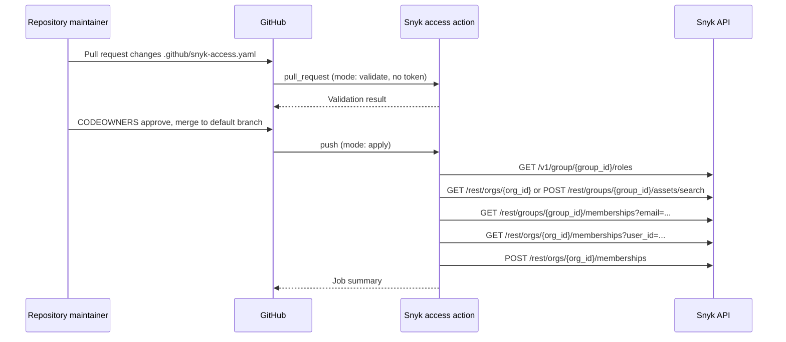

# Snyk access from repository files

A reference implementation for onboarding users to Snyk from a file in each Git repository. Each repository declares who can access its Snyk Organization in `.github/snyk-access.yaml`. A GitHub Action reads the file after a change merges and adds the listed users to the Snyk Organization with fixed roles.

This repository implements the Walk phase of a user mapping design:

- Every entry in `org_admins` receives the Org Admin role.
- Every entry in `users` receives a single developer role that you define in the Snyk Group.
- The action only adds memberships. It never removes a user or changes the role of an existing member.

## Contents

| Path | Purpose |
| --- | --- |
| `action.yml` | Composite GitHub Action that each repository calls |
| `scripts/snyk-access-sync.sh` | Validation and sync logic, using `yq`, `jq`, and `curl` |
| `schema/snyk-access.schema.json` | JSON Schema for editor autocomplete and validation of the access file |
| `examples/.github/` | Files to copy into each repository: the access file, the workflow, and `CODEOWNERS` |
| `tests/` | Tests that run the script against a local mock of the Snyk API |

## How it works

1. A repository maintainer adds or updates `.github/snyk-access.yaml` through a pull request.
2. The workflow validates the file on the pull request. This check runs offline and receives no Snyk token.
3. A `CODEOWNERS` reviewer approves the change, and the pull request merges to the default branch.
4. The workflow runs on the push to the default branch and does the following:
    - Validates the file again, then checks that both role IDs exist in the Snyk Group.
    - Resolves the Snyk Organization from `organization.id`, or from the repository URL through the Asset Search API. It confirms that the Snyk Organization belongs to the Snyk Group.
    - Looks up the Snyk user ID for each email through the Group Membership API.
    - Creates each missing Org Membership through the Org Membership API.
    - Writes a job summary that lists users added, users skipped, and emails it could not resolve.

If any validation rule fails, the run fails before it makes any membership change. The script also finishes every user lookup before it creates the first membership.



## Repository access file

The file lives at `.github/snyk-access.yaml`. Keeping it under `.github` lets `CODEOWNERS` and branch protection control who can change it. It also keeps it separate from the `.snyk` policy file that the Snyk CLI reads.

```yaml
# .github/snyk-access.yaml
version: 1

organization:
  # Optional. When omitted, the GitHub Action resolves the
  # Snyk Organization from the repository URL.
  id: 00000000-0000-0000-0000-000000000000

org_admins:
  - email: org.admin.one@example.com
  - email: org.admin.two@example.com

users:
  - email: developer.one@example.com
  - email: developer.two@example.com
  - email: security.champion@example.com
```

### Fields

| Field | Required | Description |
| --- | --- | --- |
| `version` | Yes | Schema version. The only supported value is `1`. |
| `organization.id` | No | Snyk Organization ID. When omitted, the action resolves the Snyk Organization from the repository URL through the Asset Search API. |
| `org_admins` | Yes | Users who receive the Org Admin role. The list must contain at least one entry. |
| `users` | No | Users who receive the developer role. |
| `org_admins[].email`, `users[].email` | Yes | Email address on the Snyk account of the user. |

### Validation rules

- The file is one valid YAML document and declares a supported `version`.
- The file contains no unknown keys. An entry cannot set its own role, because the list an entry is in decides its role.
- Each email appears only once across `org_admins` and `users`. The comparison ignores case.
- `organization.id`, when present, is a UUID of a Snyk Organization in the Snyk Group.
- The Org Admin role and the developer role both exist in the Snyk Group.

Add the following line to the top of the file for autocomplete and inline validation in editors that use the YAML language server:

```yaml
# yaml-language-server: $schema=https://raw.githubusercontent.com/snyk-ps/github-user-mapping/main/schema/snyk-access.schema.json
```

Point the URL at your copy of this repository. The schema checks structure only. The action enforces the rules that need the Snyk API.

## Set up Snyk

Complete these steps once for the Snyk Group.

1. Create the developer role. In the Snyk Group settings, create an Organization-level member role with the permissions every developer needs.
2. Create a Snyk Group service account for the action. Its role needs the following permissions:
    - View Groups (`group.read`), for Asset Search and the Group role list
    - View Group Memberships (`group.membership.read`)
    - View Organization (`org.read`)
    - View Organization Memberships (`org.membership.read`)
    - Add Organization Memberships (`org.membership.add`)
3. Find the IDs of the Org Admin role and the developer role. Run the following command with the service account token and use the `publicId` values:

    ```bash
    curl -s -H "Authorization: token $SNYK_TOKEN" \
      "https://api.snyk.io/v1/group/$SNYK_GROUP_ID/roles" | jq '.[] | {name, publicId}'
    ```

Users must already exist in the Snyk Group. A user joins the Snyk Group when they first log in through SSO or accept an invitation. The action skips an email with no matching Snyk user and lists it in the job summary. The next run picks it up.

## Set up GitHub

1. Copy this repository into your GitHub organization and tag a release, for example `v1`.
2. If the copy is private or internal, allow other repositories to use it. Navigate to **Settings** > **Actions** > **General** > **Access** in the copy and select the option that allows access from repositories in your organization.
3. Add the following at the GitHub organization level, so that every repository inherits them:

    | Name | Type | Value |
    | --- | --- | --- |
    | `SNYK_ACCESS_TOKEN` | Secret | Token of the Snyk Group service account |
    | `SNYK_GROUP_ID` | Variable | Snyk Group ID |
    | `SNYK_ORG_ADMIN_ROLE_ID` | Variable | `publicId` of the Org Admin role |
    | `SNYK_DEVELOPER_ROLE_ID` | Variable | `publicId` of the developer role |

    Storing the role IDs as variables means the action does not need to look up roles by name at run time.

## Add Snyk access to a repository

1. Copy the files from `examples/.github/` into the `.github/` directory of the repository:
    - `snyk-access.yaml`: replace the example emails, and set or remove `organization.id`
    - `workflows/snyk-access.yml`: replace `snyk-ps/github-user-mapping@v1` with your copy
    - `CODEOWNERS`: replace `@your-org/snyk-admins` with the team that approves Snyk access
2. Protect the default branch with a branch protection rule or ruleset:
    - Require a pull request before merging.
    - Require review from Code Owners.

    Do not make the `validate` job a required status check. It only runs when the access file changes, so a required check blocks every other pull request.
3. Create a GitHub environment named `snyk-access` in the repository, and limit its deployment branches to the default branch. The sync job uses this environment, so the token is only available to runs from the default branch.
4. Open a pull request with the files. After it merges, the sync job runs and adds the users.

To rerun a sync without changing the file, for example after a user logs in to Snyk for the first time, run the workflow manually from the **Actions** tab.

## Action reference

### Inputs

| Input | Default | Description |
| --- | --- | --- |
| `mode` | `apply` | `validate` checks the file only. `dry-run` resolves the Snyk Organization and users and reports what would change. `apply` creates the missing memberships, and only runs from the default branch. |
| `access-file` | `.github/snyk-access.yaml` | Path to the access file |
| `snyk-token` | | Snyk Group service account token. Required for `dry-run` and `apply`. |
| `group-id` | | Snyk Group ID. Required for `dry-run` and `apply`. |
| `org-admin-role-id` | | Role ID assigned to `org_admins`. Required for `dry-run` and `apply`. |
| `developer-role-id` | | Role ID assigned to `users`. Required for `dry-run` and `apply`. |
| `api-url` | `https://api.snyk.io` | Snyk API base URL. Use the regional URL for tenants outside the default region, for example `https://api.eu.snyk.io`. |
| `api-version` | `2025-11-05` | Snyk REST API version |
| `assets-api-version` | `api-version` | REST API version for Asset Search |
| `fail-on-unresolved` | `false` | Fail the run when an email has no matching user in the Snyk Group |

### Outputs

| Output | Description |
| --- | --- |
| `org-id` | Snyk Organization ID the memberships were applied to |
| `added-count` | Number of memberships created |
| `failed-count` | Number of memberships the action could not create |
| `unresolved-count` | Number of emails with no matching user in the Snyk Group |

### Results in the job summary

| Result | Meaning |
| --- | --- |
| Added | The action created the membership. |
| Would add (dry run) | `dry-run` mode found a missing membership and made no change. |
| Skipped: already has this role | The user is already a member with the role from the file. |
| Skipped: has a different role | The user is already a member with another role. The action does not change existing roles. |
| Failed | The Snyk API rejected the request. The run fails. |

The action retries a request up to three times on HTTP 429, server errors, and network errors.

## Design decisions and open questions

- User removal is out of scope. Removing an email from the file does not remove the user from the Snyk Organization.
- The action does not change the role of an existing member. A user listed in `org_admins` who is already a developer stays a developer, and the job summary reports it. An Org Admin must change the role in Snyk.
- An email with no matching user in the Snyk Group is skipped and reported. Inviting the user is a candidate for a later phase. Set `fail-on-unresolved: true` to fail the run instead.
- When several repositories map to the same Snyk Organization, the result is the union of their files, because the action only adds memberships. If two files list the same email with different roles, the first run to add the user wins. Assign one owning repository per Snyk Organization if this is a problem.
- When a repository URL maps to more than one Snyk Organization, the run fails and asks for `organization.id`.
- Asset Search (`POST /rest/groups/{group_id}/assets/search`) is an Early Access API. If it is not available in your Snyk Group, set `organization.id` in every file.

## Development

The script needs Bash, `curl`, `jq`, and the [mikefarah/yq](https://github.com/mikefarah/yq) build of `yq` version 4. GitHub-hosted Ubuntu runners include all of them.

Run the checks locally:

```bash
shellcheck scripts/*.sh
actionlint .github/workflows/*.yml examples/.github/workflows/*.yml
python3 -m pytest tests
```

Run the script against a real Snyk Group without making changes:

```bash
MODE=dry-run \
ACCESS_FILE=examples/.github/snyk-access.yaml \
REPO_URL=https://github.com/your-org/your-repo \
SNYK_TOKEN=... SNYK_GROUP_ID=... \
SNYK_ORG_ADMIN_ROLE_ID=... SNYK_DEVELOPER_ROLE_ID=... \
./scripts/snyk-access-sync.sh
```
